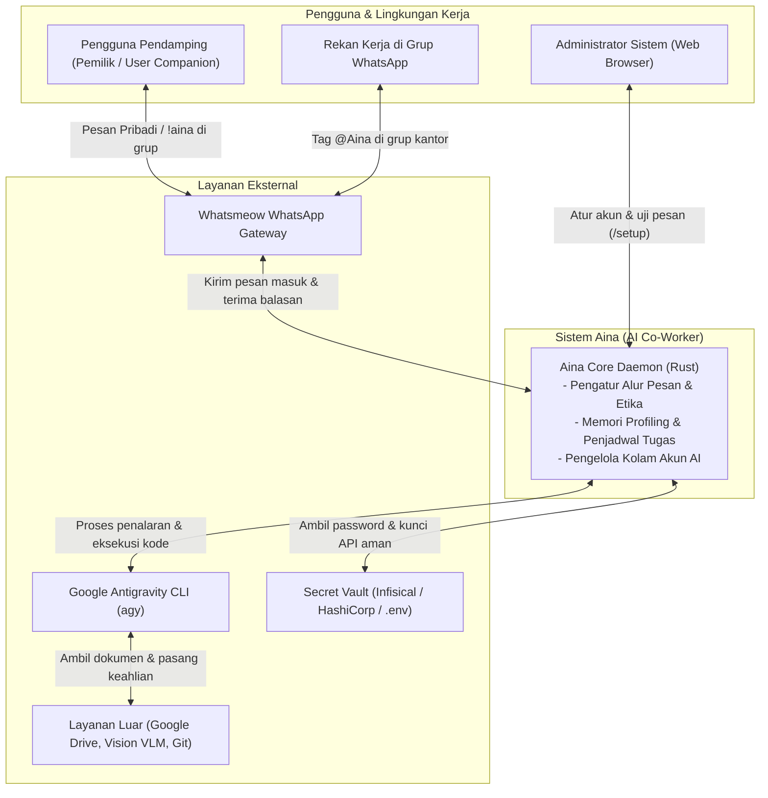

# 3. Konteks dan Cakupan (Context and Scope)

> [!INFO] **Architecture Provenance & Freshness**
> - **Verified Commit**: `e9b88a2` (branch: `main`)
> - **Verified Timestamp**: `2026-10-26T11:19:12+07:00`
> - **Tracked Paths**: `src/`, `config/`, `skills/`
> - **Drift Status**: `verified`

Bab ini memetakan batasan sistem Aina: apa yang ada di dalam sistem (tanggung jawab Aina) dan apa yang ada di luar sistem (pihak atau layanan lain yang terhubung).

---

## 3.1 Konteks Bisnis dan Pengguna (Business Context)

Diagram berikut menggambarkan bagaimana manusia dan sistem di sekitar berinteraksi dengan Aina:

### Penjelasan Peran di Sekitar Sistem:
1. **Pengguna Pendamping (*User Companion*)**: Orang yang memiliki dan bertanggung jawab atas Aina. Memiliki wewenang tertinggi (`admin`), dapat memberi instruksi rahasia lewat obrolan pribadi, dan menjadi penentu izin jika ada pihak luar meminta data sensitif.
2. **Rekan Kerja di Grup**: Anggota tim kantor yang berada di satu grup obrolan. Bisa bertanya atau meminta bantuan data jika menyebut nama Aina (`@Aina`).
3. **Administrator Web**: Pengembang atau pemilik server yang menghubungkan akun Google pertama kali melalui tampilan web ramah pengguna di peramban (*browser*).

---

## 3.2 Konteks Teknis dan Daftar Antarmuka (Technical Context & Interfaces)

Aina terhubung ke dunia luar melalui antarmuka teknis terstandarisasi. Tabel berikut merinci seluruh antarmuka yang digunakan:

| ID Antarmuka | Nama Antarmuka | Protokol | Pihak Sumber | Pihak Tujuan | Deskripsi Singkat & Kegunaan |
|:---|:---|:---|:---|:---|:---|
| IF-01 | Webhook Ingress WhatsApp | HTTP POST (JSON) | Whatsmeow Gateway | Aina Webhook Server | Menerima pemberitahuan seketika saat ada pesan baru masuk dari WhatsApp (teks, media, mention). |
| IF-02 | WhatsApp Egress Client | HTTP POST (JSON) | Aina Core | Whatsmeow Gateway | Mengirimkan pesan balasan, tanda centang/baca, dan indikator mengetik (*typing indicator*) ke WhatsApp. |
| IF-03 | Antigravity Agent Engine Runner | Subprocess (stdin/stdout pipe) | Aina Core | Google Antigravity CLI (`agy`) | Menjalankan proses penalaran agen AI, pemilihan alat (*tool calls*), serta eksekusi kode terminal di sandbox. |
| IF-04 | Penyimpanan Data SQLite | Rust Crate (`rusqlite`) | Aina Core | Database File (`aina.db`) | Menyimpan sesi obrolan, riwayat pesan, profil peran rekan kerja, dan direktori anggota grup secara lokal. |
| IF-05 | Web Setup & Simulator UI | HTTP / REST API (HTML, JSON) | Web Browser Admin | Aina Web Server | Halaman web `/setup` untuk aktivasi akun Google via OAuth PKCE, memilih model AI, serta simulator chat real-time. |
| IF-06 | Runtime Secret Broker | CLI Subprocess (`secret_tool`) | Aina Tools / Skills | Brankas Rahasia (Infisical / Vault) | Mengambil kunci API dan sandi secara aman tepat saat alat akan dijalankan tanpa menyimpannya di file teks. |
| IF-07 | External Cloud & Skill APIs | HTTPS / REST / Git | Aina Sandbox Skills | Layanan Cloud Eksternal | Mengunduh file dari Google Drive, mengekstrak tabel dokumen via VLM, serta mengunduh skill baru dari Git. |
