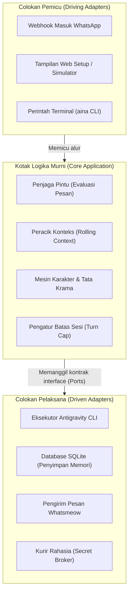

# 4. Strategi Solusi (Solution Strategy)

> [!INFO] **Architecture Provenance & Freshness**
> - **Verified Commit**: `e9b88a2` (branch: `main`)
> - **Verified Timestamp**: `2026-10-26T11:19:12+07:00`
> - **Tracked Paths**: `src/`, `config/`, `skills/`
> - **Drift Status**: `verified`

Bab ini menjelaskan strategi rancangan fundamental yang dipilih untuk menyelesaikan masalah-masalah utama dalam Aina. Setiap strategi dipilih dengan pertimbangan praktis agar sistem tangguh, aman, dan mudah dimengerti.

---

## 4.1 Pemisahan Arsitektur Bersih (Hexagonal / Ports & Adapters)

Aina memisahkan kode program menjadi dua bagian besar: **Logika Inti (*Core*)** dan **Colokan Penghubung Luar (*Adapters*)**.

### Mengapa pola ini dipilih?
1. **Bebas Ketergantungan Luar**: Logika bisnis (misalnya aturan kapan harus membalas, bagaimana merangkum obrolan, dan batasan sesi) murni ditulis tanpa mencampur aduk kode jaringan HTTP atau SQL.
2. **Mudah Diuji**: Kita bisa menguji apakah aturan penjaga gerbang bekerja dengan benar tanpa perlu menyalakan WhatsApp sungguhan.
3. **Mudah Diganti**: Jika suatu saat gerbang WhatsApp diganti dengan penyedia lain, kita hanya perlu mengubah colokan pengirim (*adapter*) tanpa menyentuh otak utama Aina.

---

## 4.2 Strategi Jalur Ganda WhatsApp (Dual-WhatsApp Pipeline)

Untuk mengatasi hambatan birokrasi di mana bot baru dilarang masuk grup kerja, Aina mengadopsi strategi **Jalur Ganda**:

1. **Jalur 1: Nomor Bot Resmi (`PrimaryBot`)**:
   - Diberi nomor khusus.
   - Digunakan untuk melayani pesan pribadi (*DM*) dari siapa saja dan grup-grup yang memang secara resmi mengundang bot.
2. **Jalur 2: Sensor Bayangan Akun Pribadi (`UserCompanion`)**:
   - Terhubung menggunakan nomor WhatsApp pribadi pemilik bot.
   - **Prinsip Nol Kebocoran Privasi**: Obrolan pribadi orang lain dengan pemilik bot diabaikan 100% dan tidak pernah dibaca oleh AI.
   - **Perekam Pasif di Grup**: Aina menyimak percakapan grup kantor tempat pemilik bergabung, mencatat topik penting ke database lokal.
   - **Pemanggilan Khusus**: Jika pemilik mengetik `!aina` di grup, atau mengirim pesan ke nomor sendiri (*Message Yourself*), Aina segera merespon sebagai asisten pribadi.

---

## 4.3 Strategi Kolam Akun & Rotasi Kuota Otomatis

Untuk mencegah AI berhenti bekerja saat kuota harian habis (*rate limit 429*):
- Pengguna dapat menghubungkan banyak akun Google (misalnya 5 hingga 10 akun) ke dalam sistem.
- Aina menjalankan sistem **Giliran Berputar (*Round-Robin*)**: setiap sesi percakapan baru dilayani oleh akun bergantian.
- Jika sebuah akun mendadak terkena batas kuota di tengah proses, sistem otomatis mendeteksi error tersebut dan segera mengalihkan tugas ke akun berikutnya (*Auto-Failover*) tanpa membuat balasan pesan gagal.

---

## 4.4 Strategi Penjaga Pintu & Konteks Obrolan Berjalan

Agar Aina tidak membuat kebisingan di grup kantor namun tetap cerdas saat diajak bicara:
1. **Penyaringan Pesan Masuk (*Gatekeeper*)**:
   - Jika pesan masuk dari obrolan pribadi: Selalu diproses dan dijawab.
   - Jika pesan masuk dari grup: Diperiksa apakah menyebut `@Aina`, mengutip pesan Aina, atau diawali tanda seru `!aina`. Jika tidak, statusnya adalah `RecordOnly` (hanya dicatat diam-diam di database lokal).
2. **Konteks Berjalan (*Rolling Context*)**:
   - Saat ada orang yang memanggil `@Aina` di grup, sistem otomatis menarik 10–20 pesan terakhir sebelum pemanggilan tersebut.
   - Konteks obrolan disisipkan ke dalam instruksi agen sehingga Aina langsung memahami duduk persoalan tanpa meminta orang tersebut mengulang ceritanya.

---

## 4.5 Strategi Batasan Sesi & Pemulihan Mandiri (Turn Cap & Self-Healing)

Percakapan yang terlalu panjang berisiko membuat model AI boros token, lambat, atau kehilangan fokus.
- **Batas Giliran Sesi (*Deterministic Session Turn Cap*)**: Setiap sesi obrolan dibatasi hingga jumlah giliran tertentu. Jika batas tercapai, sistem secara otomatis merangkum inti obrolan lama menjadi ringkasan padat (*lean resumed prompt*) dan membuka sesi baru di balik layar.
- **Pemulihan Aliran Putus (*Self-Healing Stream Fallback*)**: Jika aliran jaringan antara server dan model AI terputus tiba-tiba, sistem menangkap sisa teks yang berhasil keluar dan meminta model melanjutkan bagian yang terpotong secara otomatis.

---

## 4.6 Strategi Pemisahan Keahlian & Kurir Kunci Rahasia (Custom Skills & Secret Broker)

1. **Inti Program yang Netral**: Repositori utama bebas dari kode spesifik kantor. Siapa pun dapat menggunakan Aina untuk keperluan apa pun.
2. **Keahlian Khusus Modular (`data/custom-skills`)**: Fitur khusus kantor (seperti kueri data internal, cek disposisi surat, atau ekstraksi dokumen dinas) ditempatkan di folder terpisah. Aina menyediakan perintah `aina skill install <repo-git>` untuk memasang keahlian tambahan secara instan.
3. **Penyuntikan Rahasia Tepat Waktu (*Just-in-Time Secret Broker*)**: Kunci API atau password tidak disimpan di kode atau lingkungan sistem permanen. Saat skrip membutuhkan kunci, skrip meminta izin ke Secret Broker. Setelah eksekusi selesai, kredensial segera dibersihkan dari memori.
