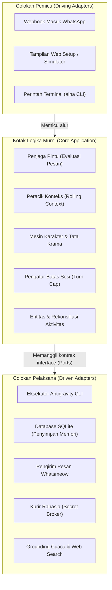

# 4. Strategi Solusi (Solution Strategy)

> [!INFO] **Architecture Provenance & Freshness**
> - **Verified Commit**: `17f951a` (branch: `main`)
> - **Verified Timestamp**: `2026-11-21T10:53:50+07:00`
> - **Tracked Paths**: `src/core/domain/capability.rs`, `src/core/domain/audit/`, `src/core/usecases/process_message/`
> - **Drift Status**: `verified`

Bab ini menjelaskan strategi rancangan fundamental yang dipilih untuk menyelesaikan masalah-masalah utama dalam Aina. Setiap strategi dipilih dengan pertimbangan praktis agar sistem tangguh, aman, dan mudah dimengerti.

---

## 4.1 Pemisahan Arsitektur Bersih (Hexagonal / Ports & Adapters)

Aina memisahkan kode program menjadi dua bagian besar: **Logika Inti (*Core*)** dan **Colokan Penghubung Luar (*Adapters*)**.

### Mengapa pola ini dipilih?
1. **Bebas Ketergantungan Luar**: Logika bisnis (misalnya aturan kapan harus membalas, bagaimana merangkum obrolan, dan batasan sesi) murni ditulis tanpa mencampur aduk kode jaringan HTTP atau SQL.
2. **Mudah Diuji**: Kita bisa menguji apakah aturan penjaga gerbang bekerja dengan benar tanpa perlu menyalakan WhatsApp sungguhan.
3. **Mudah Diganti**: Jika suatu saat gerbang WhatsApp diganti dengan penyedia lain, kita hanya perlu mengubah colokan pengirim (*adapter*) tanpa menyentuh otak utama Aina.

---

## 4.2 Strategi Jalur Ganda WhatsApp (Dual-WhatsApp Pipeline)

Untuk mengatasi hambatan birokrasi di mana bot baru dilarang masuk grup kerja, Aina mengadopsi strategi **Jalur Ganda**:

1. **Jalur 1: Nomor Bot Resmi (`PrimaryBot`)**:
   - Diberi nomor khusus.
   - Digunakan untuk melayani pesan pribadi (*DM*) dari siapa saja dan grup-grup yang memang secara resmi mengundang bot.
2. **Jalur 2: Sensor Bayangan Akun Pribadi (`UserCompanion`)**:
   - Terhubung menggunakan nomor WhatsApp pribadi pemilik bot.
   - **Prinsip Nol Kebocoran Privasi**: Obrolan pribadi orang lain dengan pemilik bot diabaikan 100% dan tidak pernah dibaca oleh AI.
   - **Perekam Pasif di Grup**: Aina menyimak percakapan grup kantor tempat pemilik bergabung, mencatat topik penting ke database lokal.
   - **Pemanggilan Khusus**: Jika pemilik mengetik `!aina` di grup, atau mengirim pesan ke nomor sendiri (*Message Yourself*), Aina segera merespon sebagai asisten pribadi.

---

## 4.3 Strategi Kolam Akun & Rotasi Kuota Otomatis

Untuk mencegah AI berhenti bekerja saat kuota harian habis (*rate limit 429*):
- Pengguna dapat menghubungkan banyak akun Google (misalnya 5 hingga 10 akun) ke dalam sistem.
- Aina menjalankan sistem **Giliran Berputar (*Round-Robin*)**: setiap sesi percakapan baru dilayani oleh akun bergantian.
- Jika sebuah akun mendadak terkena batas kuota di tengah proses, sistem otomatis mendeteksi error tersebut dan segera mengalihkan tugas ke akun berikutnya (*Auto-Failover*) tanpa membuat balasan pesan gagal.

---

## 4.4 Strategi Penjaga Pintu & Konteks Obrolan Berjalan

Agar Aina tidak membuat kebisingan di grup kantor namun tetap cerdas saat diajak bicara:
1. **Penyaringan Pesan Masuk (*Gatekeeper*)**:
   - Jika pesan masuk dari obrolan pribadi: Selalu diproses dan dijawab.
   - Jika pesan masuk dari grup: Diperiksa apakah menyebut `@Aina`, mengutip pesan Aina, atau diawali tanda seru `!aina`. Jika tidak, statusnya adalah `RecordOnly` (hanya dicatat diam-diam di database lokal).
2. **Konteks Berjalan (*Rolling Context*)**:
   - Saat ada orang yang memanggil `@Aina` di grup, sistem otomatis menarik 10–20 pesan terakhir sebelum pemanggilan tersebut.
   - Konteks obrolan disisipkan ke dalam instruksi agen sehingga Aina langsung memahami duduk persoalan tanpa meminta orang tersebut mengulang ceritanya.

---

## 4.5 Strategi Batasan Sesi & Pemulihan Mandiri (Turn Cap & Self-Healing)

Percakapan yang terlalu panjang berisiko membuat model AI boros token, lambat, atau kehilangan fokus.
- **Batas Giliran Sesi (*Deterministic Session Turn Cap*)**: Setiap sesi obrolan dibatasi hingga jumlah giliran tertentu. Jika batas tercapai, sistem secara otomatis merangkum inti obrolan lama menjadi ringkasan padat (*lean resumed prompt*) dan membuka sesi baru di balik layar.
- **Pemulihan Aliran Putus (*Self-Healing Stream Fallback*)**: Jika aliran jaringan antara server dan model AI terputus tiba-tiba, sistem menangkap sisa teks yang berhasil keluar dan meminta model melanjutkan bagian yang terpotong secara otomatis.

---

## 4.6 Strategi Pemisahan Keahlian & Kurir Kunci Rahasia (Custom Skills & Secret Broker)

1. **Inti Program yang Netral**: Repositori utama bebas dari kode spesifik kantor. Siapa pun dapat menggunakan Aina untuk keperluan apa pun.
2. **Keahlian Khusus Modular (`data/custom-skills`)**: Fitur khusus kantor (seperti kueri data internal, cek disposisi surat, atau ekstraksi dokumen dinas) ditempatkan di folder terpisah. Aina menyediakan perintah `aina skill install <repo-git>` untuk memasang keahlian tambahan secara instan.
3. **Penyuntikan Rahasia Tepat Waktu (*Just-in-Time Secret Broker*)**: Kunci API atau password tidak disimpan di kode atau lingkungan sistem permanen. Saat skrip membutuhkan kunci, skrip meminta izin ke Secret Broker. Setelah eksekusi selesai, kredensial segera dibersihkan dari memori.

---

## 4.7 Strategi Rekonsiliasi Aktivitas Hibrida (Declarative Baseline & Persistent Custom Activities)

Untuk memecahkan masalah hilangnya jadwal rutin saat kontainer Docker/Coolify di-redeploy:
- **Baseline Activities**: Didefinisikan secara deklaratif di `config/activities.default.json` (termasuk briefing pagi, status WhatsApp harian, pengingat akhir bulan).
- **Custom Activities & Modifikasi**: Disimpan di volume persisten `/app/data/activities/<slug>.json` dan basis data SQLite.
- **Mesin Rekonsiliator (*ActivityReconciler*)**: Dijalankan otomatis saat bot booting (`ActivityReconciler::sync_all`). Aturan resolusi prioritas:
  $$\text{Custom File Override} > \text{SQLite Active State} > \text{Declarative Baseline}$$
- **CLI Terpadu**: Pengguna dapat memodifikasi aktivitas kapan saja via terminal (`aina activity edit <slug> --append "..." --file`).

---

## 4.8 Strategi Penemuan Keahlian Bertingkat (Three-Tier Progressive Disclosure)

Mengadopsi standar terbuka internasional **`agentskills.io`**:
1. **Tier 1 (Discovery)**: Saat inisialisasi, hanya metadata nama dan deskripsi YAML frontmatter yang dimuat (~40 token per skill).
2. **Tier 2 (Activation)**: Ketika instruksi pengguna cocok dengan deskripsi skill, agen secara mandiri membaca isi lengkap berkas `SKILL.md`.
3. **Tier 3 (Execution)**: Skrip eksekutabel di folder `scripts/` dijalankan di subproses bash dengan output terstruktur (`--json`), mencegah kode mentah mencemari jendela konteks LLM.
4. **Hot Container Auto-Discovery**: Symlink otomatis dari `/app/data/custom-skills` ke `.agents/skills/` membuat skill baru langsung terdeteksi pada turn berikutnya tanpa perlu me-restart kontainer.

---

## 4.9 Strategi Refleksi Pengalaman & Grounding Lingkungan (Experiential Reflection)

Terinspirasi dari *Gibbs' Reflective Cycle* dan arsitektur refleksi *Stanford Generative Agents*:
1. **Pemanenan Bukti**: Mengaudit riwayat tugas terjadwal (`aina activity runs`), jurnal visual (`data/status_journal.jsonl`), dan aksi chat.
2. **Deteksi Kejenuhan (*Boredom Engine*)**: Menghitung frekuensi pengulangan tema dan pakaian; memicu variasi jika skor kebosanan $\ge 0.5$.
3. **Grounding Fisik Khatulistiwa**: Mengambil data cuaca real-time Pontianak (suhu, hujan, kelembapan) via Open-Meteo API tanpa menebak.
4. **Riset Web Terarah (*Gated Novelty Web Search*)**: Memformulasikan 1–2 kueri pencarian tajam untuk memperkaya latar sensorik kuliner dan destinasi lokal.
5. **Adaptasi Otonom**: Menyuntikkan hasil refleksi ke aktivitas terjadwal via CLI (`aina activity edit <slug> --append "..." --file`).

---

## 4.10 Strategi Pertahanan Berlapis & Audit Anti-Sangkalan (Zero Implicit Trust & Non-Repudiation)

Untuk menjamin keamanan kelas enterprise di lingkungan instansi pemerintah (BPS):
1. **Model Otoritas 4-Tingkat Terisolasi Konfigurasi**:
   - Status `ADMIN` terikat pada konfigurasi nomor WhatsApp Companion, bukan pada basis data atau teks pesan masuk.
   - Hak istimewa pimpinan satker (`ATASAN`) dan rekan kerja (`STAFF`) dipisahkan secara tegas dari tamu luar (`GUEST`).
2. **Tiket Kapabilitas Sementara (*Scoped Turn Capability*)**:
   - Setiap pesan masuk menerbitkan tiket otorisasi unik dengan masa berlaku terbatas (TTL 10 menit) yang mengikat `principal_jid`, `authority`, dan `message_id`. Seluruh eksekusi tool memverifikasi tiket ini.
3. **Audit Trail Rantai Hash SHA-256 Bergaya Blockchain (NIST AU-10 & ISO 42001)**:
   - Setiap pemanggilan tool oleh AI dienkapsulasi dengan hash SHA-256 yang merantai blok sebelumnya ($H_n = \text{SHA256}(H_{n-1} \parallel \dots)$), menjamin integritas bukti forensik anti-manipulasi.
4. **Pertahanan Kebocoran Nomor WhatsApp (*Phone Leakage Cognitive Fence*)**:
   - Nomor tak dikenal otomatis diperlakukan sebagai tamu (`GUEST`), dibatasi kuotanya (*anti-abuse rate limiting*), dan dilarang mengakses dokumen internal instansi.
5. **Kepatuhan Privasi Mandiri UU PDP (*Right to be Forgotten*)**:
   - Pengguna memiliki kendali transparansi penuh atas data profilnya (`/profilku`) serta hak penghapusan mandiri seketika (`/lupakansaya`).
6. **Pengasuhan Berkas & Discretionary Access Control (Data & File Custodianship)**:
   - Berkas dokumen (PDF, spreadsheet, draf kebijakan), skrip, maupun dataset yang dititipkan staf/atasan otomatis diikat pada identitas nomor pengunggah (*File Custodian*).
   - Pengguna lain dilarang membaca atau mengekstrak isi berkas tanpa izin eksplisit dari pemilik berkas, ditegakkan oleh gerbang *Zero-Disclosure* dan pencatatan audit rantai hash SHA-256.
---

## 4.11 Siklus Hidup Identitas 3-Tingkat (*Zero Trust Identity Lifecycle*)

Untuk mencegah rekayasa sosial di mana pihak luar mengaku sebagai admin atau atasan satker:
1. **Status Identitas 3-Tingkat**:
   - `UNCONFIRMED`: Status default untuk seluruh kontak baru atau kontak yang mengklaim nama secara mandiri.
   - `TENTATIVE`: Anggota grup kerja internal tepercaya yang telah terikat oleh kapabilitas grup.
   - `VERIFIED`: Status resmi yang hanya dapat disematkan oleh Companion via perintah CLI `aina user verify`.
2. **Pertahanan Nama Terlindungi (*Protected Name Collision Defense*)**:
   - Jika pengguna baru mengaku dengan nama admin/companion ("Ihza", "Karunia", "Admin"), profiler menolak mengeskalasi profil. Klaim disimpan di kolom terpisah `claimed_name` dengan catatan audit `SUSPICIOUS_IDENTITY_CLAIM`.
3. **Pertahanan Klaim Hirarki (*Hierarchy Claim Defense*)**:
   - Klaim sepihak seperti *"Saya Kepala BPS"* otomatis ditahan di kolom `claimed_role`, sementara status hirarki dikunci pada level `guest`. Selama status belum `VERIFIED`, evaluasi `is_atasan` wajib bernilai `false`.

---

## 4.12 Skalabilitas Konkurensi Kepadatan Tinggi (*High-Density Bounded Semaphore & Token Lease*)

Menghadapi skenario 100 pengguna chat serentak:
1. **Bounded Semaphore Tokio**: Membatasi agen serentak maksimal 8 proses (`AINA_MAX_CONCURRENT_AGENTS`). Pesan ke-9 dan seterusnya mengantre secara tertib di memori tanpa memakan alokasi RAM proses biner baru.
2. **Token Lease Aware**: Kolam akun menyaring akun yang sedang cooldown, dan memprioritaskan akun dengan `in_flight < 2`. Pola RAII guard `AccountLease` otomatis menurunkan hitungan in-flight begitu giliran selesai atau error.

---

## 4.13 Autentikasi Agnostik Berstandar Industri (OpenID Connect SSO)

Untuk memfasilitasi akses dasbor web bagi pegawai dan admin instansi tanpa mengorbankan sifat agnostik kerangka kerja Aina:
1. **Pemisahan Konfigurasi Lingkungan dari Inti Kode**: Seluruh rincian penyedia identitas (URL issuer, client ID, client secret, redirect URI) disuntikkan via environment variable, tanpa ada hardcode domain atau entitas institusi di kode sumber.
2. **Standar OIDC Authorization Code Flow & PKCE**: Memanfaatkan standar industri RFC 6749 dan RFC 7636 untuk pertukaran kredensial secara aman.
3. **Stateless Signed Session Token**: Sesi web ditandatangani menggunakan HMAC-SHA256 tanpa membebani basis data dan dapat diverifikasi secara mandiri.

---

## 4.14 Strategi Pengerasan Ingress, Minimal Dependency, & Pertahanan Berlapis (*Fase 17–20*)

Untuk mengamankan permukaan masuk web, webhook, jalur berkas, kuota WhatsApp, dan konteks ambien tanpa menambah crate wajib baru maupun vendor lock-in:
1. **Fail-Closed & Hybrid Upstream Ingress Armor (Fase 17)**: Seluruh gerbang otorisasi web bersifat fail-closed dengan `constant_time_eq` dan header-only (dengan opt-in `AINA_EVENTS_ALLOW_QUERY_KEY` khusus webhook legacy). Endpoint `/webhook` menerapkan SSRF origin-lock dan sanitasi `msg.id` secara wajib, sementara shared secret `AINA_WEBHOOK_SECRET` bersifat opsional (fail-closed saat disetel).
2. **Canonical Path Sandbox & 100% Env-Var First Secrets (Fase 18)**: Validasi ganda (`^[a-zA-Z0-9_-]{16,64}$` + canonical containment) di Rust dan Python, serta penghapusan total seluruh kredensial hardcoded (termasuk default Infisical di `secret_tool.py` dan XOR di skrip OAuth) dengan Vault eksternal tetap 100% opsional.
3. **Dual-Layer Hexagonal WhatsApp Throttling (Fase 19)**: Pemisahan bersih sesuai `ADR-001` — edge burst guard & bounded queue di lapisan Driving Adapter (`web/`), dan pure domain `TokenBucket` di `core/domain/rate_limiter.rs` yang diorkestrasi `ProcessIncomingMessageUseCase` dengan kebijakan anti-ban (maks 1x notice sopan per window, lalu silent auto-drop + tombstone).
4. **Nonce Prompt Boundary, Deterministic Target Binding, & Least-Privilege Env (Fase 20)**: Delimiter XML bernonce acak per tur + tag escaping untuk seluruh konteks untrusted, pengikatan target eksplisit pada `TurnCapability` untuk mutasi grup, dan pemutusan injeksi `WHATSMEOW_API_KEY` pada subprocess agen turn `Guest`.
