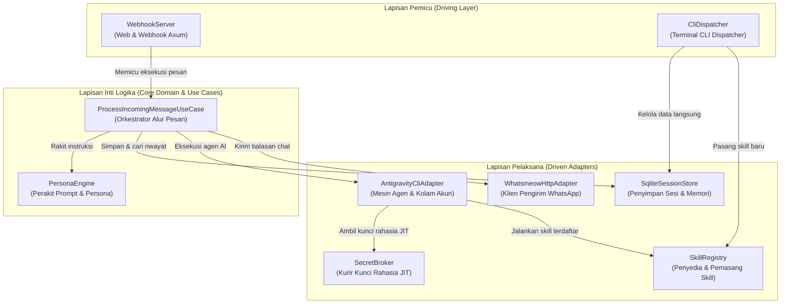

# 5. Struktur Blok Pembangun (Building Block View)

> [!INFO] **Architecture Provenance & Freshness**
> - **Verified Commit**: `e9b88a2` (branch: `main`)
> - **Verified Timestamp**: `2026-10-26T11:19:12+07:00`
> - **Tracked Paths**: `src/`, `config/`, `skills/`
> - **Drift Status**: `verified`

Bab ini memperlihatkan dekomposisi struktur perangkat lunak Aina dari tingkat umum (Level 1) hingga rincian modul di dalamnya (Level 2).

---

## 5.1 Dekomposisi Sistem Tingkat 1 (Level 1: Whitebox Overall System)

Secara garis besar, Aina tersusun atas komponen-komponen berikut yang bekerja sama memproses setiap pesan masuk:

### Tabel Komponen Blok Pembangun (Building Blocks)

Tabel berikut menghubungkan nama komponen dengan antarmuka teknis (`IF-xx`) dan lokasi kodenya di dalam repositori:

| Komponen | Deskripsi & Tanggung Jawab Utama | Antarmuka (IF-xx) | Lokasi Kode Sumber |
|:---|:---|:---|:---|
| WebhookServer | Menerima payload webhook HTTP dari gateway WhatsApp serta menyajikan antarmuka web `/setup` dan simulator chat. | IF-01, IF-05 | `src/adapters/driving/web/` |
| CliDispatcher | Menangani eksekusi perintah terminal mandiri (`aina status`, `aina user`, `aina group`, `aina archive`, dll.). | IF-04, IF-05 | `src/adapters/driving/cli/` |
| ProcessIncomingMessageUseCase | Mengatur seluruh alur pemrosesan pesan masuk: evaluasi penjaga pintu, penarikan konteks berjalan, pembatasan sesi (*turn cap*), dan penanganan error. | IF-01, IF-02, IF-03, IF-04 | `src/core/usecases/process_message/` |
| PersonaEngine | Merakit instruksi sistem (*system prompt*), aturan gaya bahasa Indonesia yang santun, adab WhatsApp, dan katalog keahlian dinamis. | IF-03 | `src/core/domain/persona.rs` |
| SqliteSessionStore | Mengelola database lokal SQLite WAL: menyimpan sesi, pesan teks penuh (FTS5), profil peran rekan kerja, dan keanggotaan grup. | IF-04 | `src/adapters/driven/sqlite_store/` |
| AntigravityCliAdapter | Menjembatani pemanggilan proses Antigravity CLI (`agy`), mengelola rotasi akun Google (*Round-Robin*), dan pemulihan saat limit kuota (*failover*). | IF-03 | `src/adapters/driven/agy_cli/` |
| WhatsmeowHttpAdapter | Mengirimkan pesan balasan teks, kutipan pesan, dan indikator mengetik (*presence*) kembali ke WhatsApp melalui gateway Whatsmeow. | IF-02 | `src/adapters/driven/whatsmeow/` |
| SecretBroker | Menyediakan kunci API dan kredensial secara aman tepat saat alat dijalankan (*Just-in-Time*), bebas dari vendor lock-in. | IF-06 | `skills/infisical/scripts/secret_tool.py` |
| SkillRegistry | Memindai keahlian bawaan dan keahlian kustom di `data/custom-skills`, serta memasang keahlian baru secara otomatis dari repositori Git. | IF-07 | `skills/skill-builder/scripts/` & `src/core/domain/metacognition/` |

---

## 5.2 Rincian Modul Inti Tingkat 2 (Level 2: Core Deep Dive)

Di dalam lapisan inti (`src/core/`), terdapat modul-modul penting yang saling terisolasi:
1. **`core::domain::Gatekeeper`**: Logika penentu apakah pesan perlu dijawab langsung, hanya disimpan pasif, atau meminta konfirmasi pemilik bot.
2. **`core::domain::SessionLifecycle`**: Logika penghitung giliran obrolan. Jika giliran mencapai batas maksimal, modul ini memicu perangkuman otomatis menjadi *lean resumed prompt*.
3. **`core::ports`**: Wadah trait abstrak (`AgentEngine`, `SessionStore`, `WhatsAppGateway`). Berkat trait ini, kode inti tidak terikat pada library eksternal mana pun.
