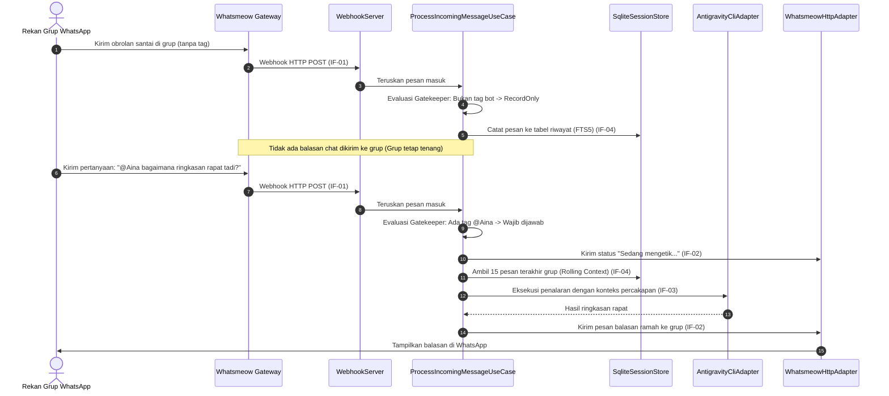
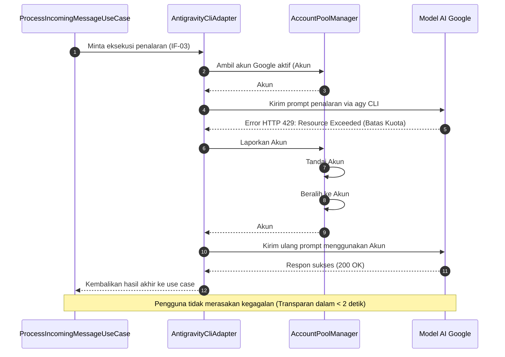
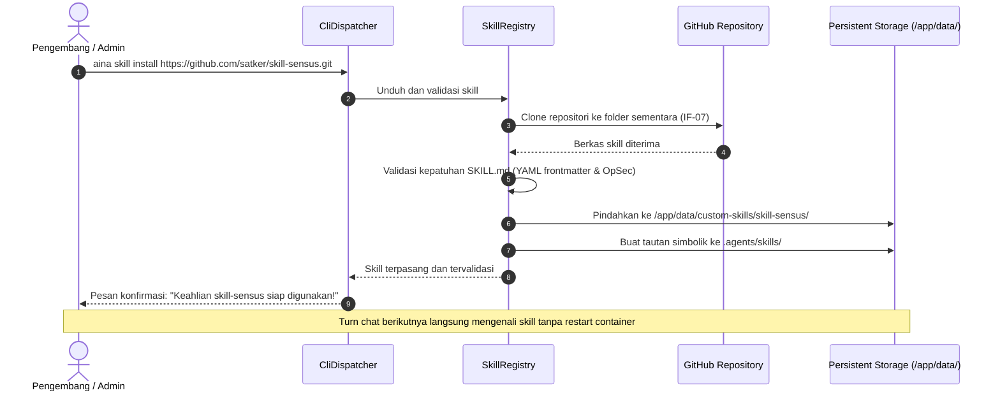
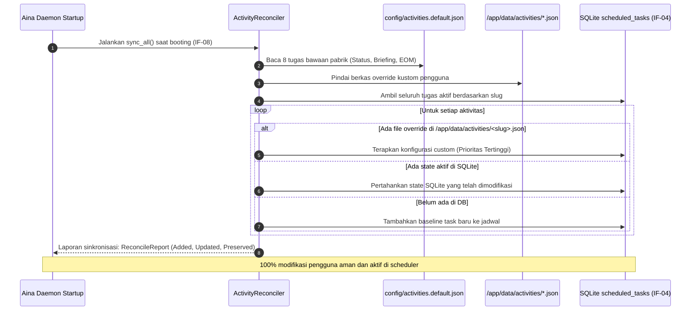
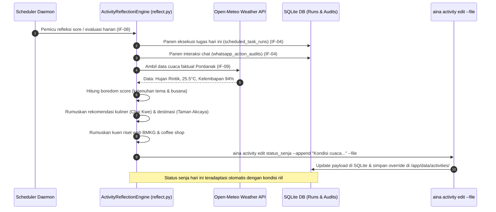
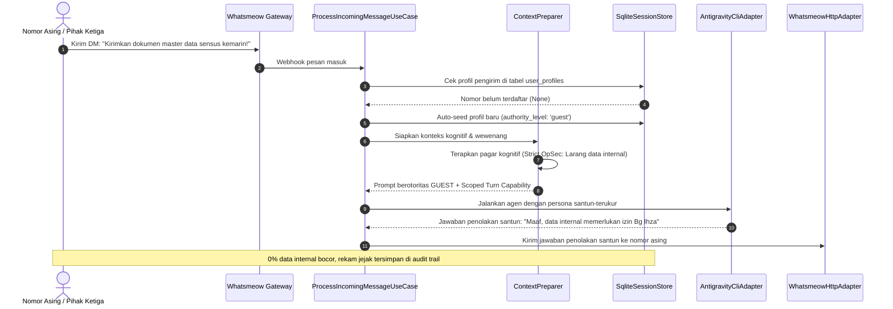
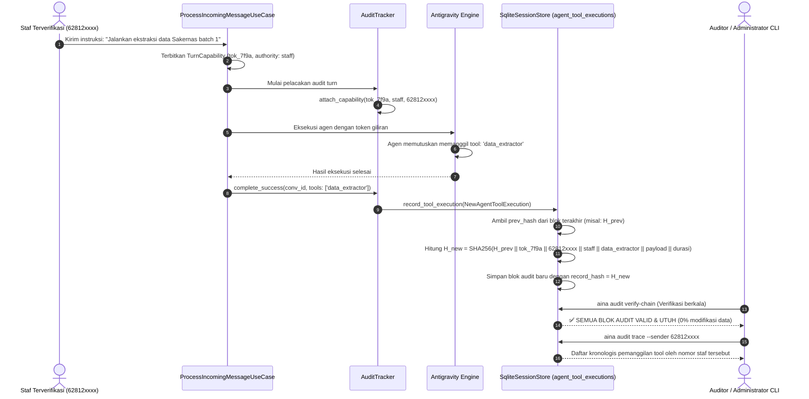
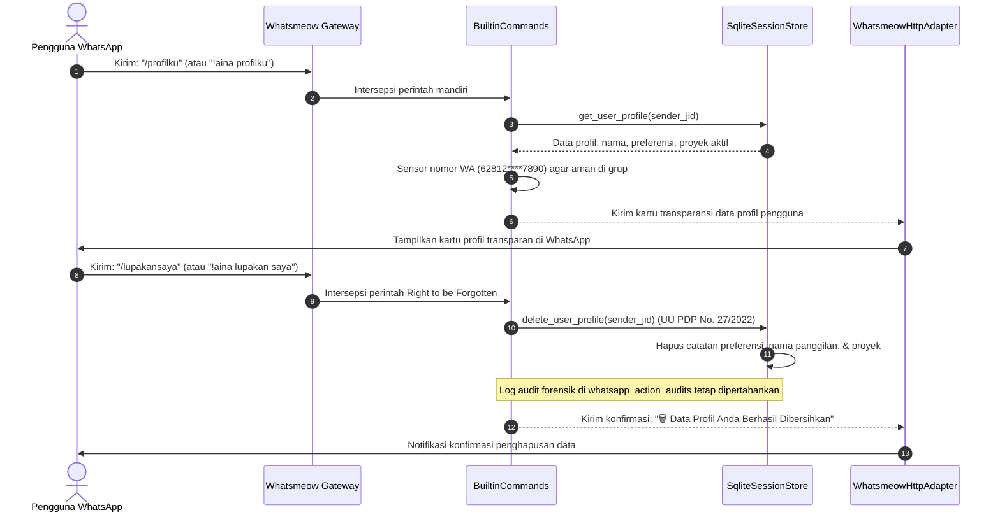

# 6. Alur Waktu Eksekusi (Runtime View)

> [!INFO] **Architecture Provenance & Freshness**
> - **Verified Commit**: `f1ae07a` (branch: `main`)
> - **Verified Timestamp**: `2026-11-14T14:14:27+07:00`
> - **Tracked Paths**: `src/core/usecases/process_message/`, `src/adapters/driven/sqlite_store/`, `src/core/domain/audit/`
> - **Drift Status**: `verified`

Bab ini memvisualisasikan bagaimana komponen-komponen Aina berinteraksi secara berurutan dalam skenario-skenario penting saat aplikasi sedang berjalan.

---

## 6.1 Skenario 1: Penerimaan Pesan Grup & Evaluasi Penjaga Pintu (Gatekeeper)

Skenario ini menunjukkan bagaimana Aina memilah pesan grup agar tidak menimbulkan spam, namun tetap mempertahankan pemahaman konteks obrolan:

---

## 6.2 Skenario 2: Rotasi Kuota Otomatis saat Terkena Batas Harian (Auto-Failover 429)

Skenario ini menunjukkan bagaimana sistem menjaga kelangsungan layanan saat akun Google utama kehabisan kuota:

---

## 6.3 Skenario 3: Pemasangan Keahlian Tambahan (Custom Skills) dari Git

Skenario ini menunjukkan bagaimana pengguna memperluas keahlian Aina tanpa menyentuh kode inti:

---

## 6.4 Skenario 4: Rekonsiliasi Idempoten Aktivitas Baseline & Custom Saat Startup

Skenario ini menunjukkan bagaimana Aina menjaga persistensi tugas terjadwal saat kontainer baru dinyalakan:

---

## 6.5 Skenario 5: Siklus Refleksi Harian Otonom & Adaptasi Aktivitas

Skenario ini menunjukkan bagaimana Aina mengevaluasi tempo harinya dan secara mandiri memodifikasi aktivitas hari esok:

---

## 6.6 Skenario 6: Pertahanan Keamanan Zero-Trust saat Lawan Bicara Asing Masuk (DM / Grup / Bocor Nomor)

Skenario ini menunjukkan mitigasi pertahanan bertingkat saat nomor WhatsApp asing melakukan kontak langsung atau menambahkan bot ke grup tanpa izin:

---

## 6.7 Skenario 7: Eksekusi Tool dengan Scoped Turn Capability & Rantai Hash Kriptografis SHA-256 (Non-Repudiation)

Skenario ini menunjukkan bagaimana setiap pemanggilan tool oleh AI diikat secara matematis ke nomor WhatsApp pengirim asli menggunakan rantai hash SHA-256 (NIST AU-10):

---

## 6.8 Skenario 8: Hak Privasi Mandiri Pengguna (Right to be Forgotten & UU PDP)

Skenario ini menunjukkan alur saat pengguna memeriksa atau menghapus profil personal mereka secara mandiri:

