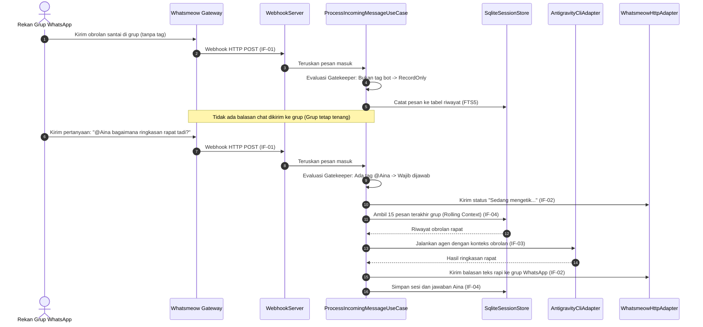
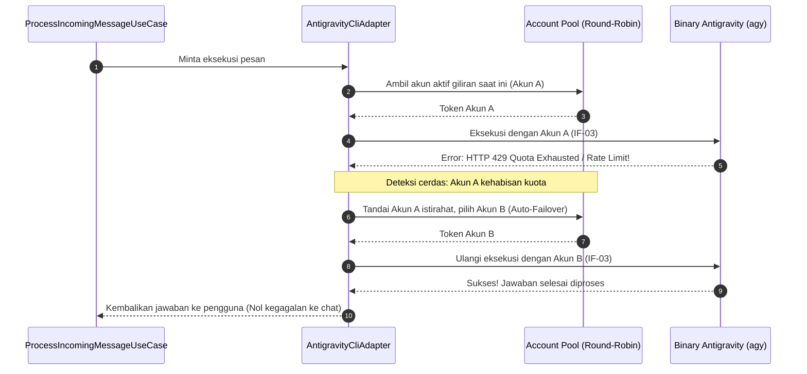
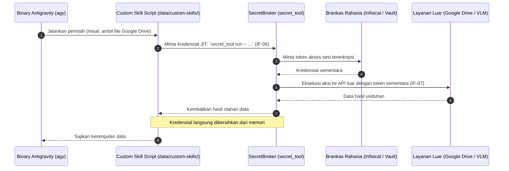
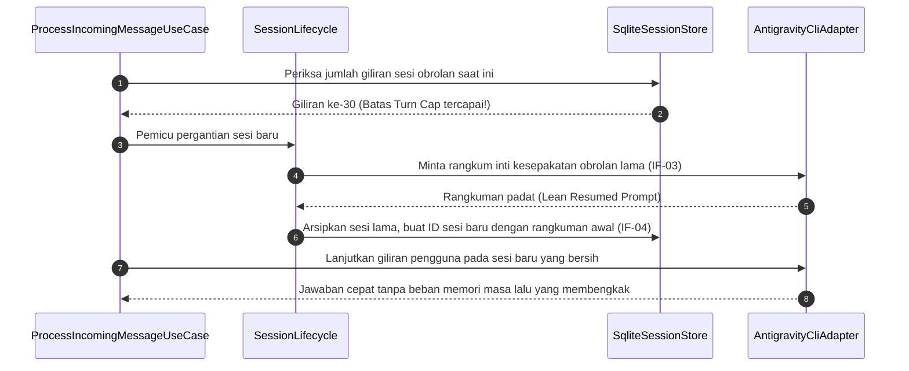

# 6. Alur Waktu Eksekusi (Runtime View)

> [!INFO] **Architecture Provenance & Freshness**
> - **Verified Commit**: `e9b88a2` (branch: `main`)
> - **Verified Timestamp**: `2026-10-26T11:19:12+07:00`
> - **Tracked Paths**: `src/`, `config/`, `skills/`
> - **Drift Status**: `verified`

Bab ini memvisualisasikan bagaimana komponen-komponen Aina berinteraksi secara berurutan dalam skenario-skenario penting saat aplikasi sedang berjalan.

---

## 6.1 Skenario 1: Penerimaan Pesan Grup & Evaluasi Penjaga Pintu (Gatekeeper)

Skenario ini menunjukkan bagaimana Aina memilah pesan grup agar tidak menimbulkan spam, namun tetap mempertahankan pemahaman konteks obrolan:

---

## 6.2 Skenario 2: Rotasi Akun Multi-Account & Penanganan Otomatis Limit Kuota (429)

Skenario ini menunjukkan keandalan Aina saat menghadapi batas pemakaian harian pada akun AI:

---

## 6.3 Skenario 3: Eksekusi Keahlian Khusus & Pengambilan Kunci Rahasia JIT

Skenario ini menggambarkan bagaimana alat kerja di sandbox meminta kunci rahasia secara aman tanpa ada kunci tersimpan statis:

---

## 6.4 Skenario 4: Pembatasan Giliran Sesi (*Turn Cap*) & Perangkuman Cerdas

Skenario ini menunjukkan bagaimana Aina menjaga efisiensi token dan mencegah agen menjadi lemot pada obrolan berhari-hari:

