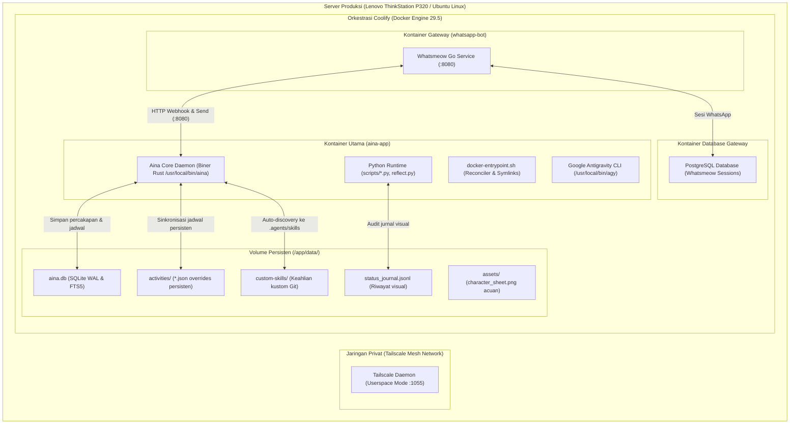

# 7. Pandangan Penerapan (Deployment View)

> [!INFO] **Architecture Provenance & Freshness**
> - **Verified Commit**: `f1ae07a` (branch: `main`)
> - **Verified Timestamp**: `2026-11-14T14:14:27+07:00`
> - **Tracked Paths**: `src/`, `config/`, `skills/`
> - **Drift Status**: `verified`

Bab ini menjelaskan topologi perangkat keras, konfigurasi kontainer Docker, pemetaan komponen blok pembangun ke lingkungan eksekusi, serta jalur volume penyimpanan permanen di server produksi tempat Aina beroperasi.

---

## 7.1 Topologi Penerapan Produksi (Production Deployment Topology)

Aina diterapkan di server fisik mandiri (*on-premises self-hosted*) yang dikelola melalui platform PaaS **Coolify**:

---

## 7.2 Pemetaan Komponen Blok Pembangun ke Node Penerapan

Tabel berikut memetakan seluruh komponen dari Bab 5 (*Building Block View*) ke kontainer fisik dan lingkungan runtime eksekusinya di server ThinkStation:

| Komponen Blok Pembangun | Kontainer / Node Eksekusi | Lingkungan Runtime & Jalur Eksekusi |
|:---|:---|:---|
| WebhookServer | `aina-app` | Axum HTTP server pada port `:3000` di dalam kontainer utama. |
| CliDispatcher | `aina-app` | Biner CLI `/usr/local/bin/aina` untuk eksekusi perintah terminal ad-hoc. |
| ProcessIncomingMessageUseCase | `aina-app` | Runtime asinkron Tokio task pool di dalam proses daemon utama. |
| PersonaEngine | `aina-app` | Modul domain Rust di dalam memori proses utama. |
| SqliteSessionStore | `aina-app` | Connection pool `rusqlite` mengakses berkas `/app/data/aina.db` di volume persisten. |
| AntigravityCliAdapter | `aina-app` | Subprocess runner yang memanggil biner Google Antigravity CLI (`/usr/local/bin/agy`). |
| WhatsmeowHttpAdapter | `aina-app` | HTTP client asinkron yang berkomunikasi dengan kontainer `whatsapp-bot:8080`. |
| SecretBroker | `aina-app` | Skrip Python `skills/infisical/scripts/secret_tool.py` yang dieksekusi secara Just-in-Time. |
| SkillRegistry | `aina-app` | Modul Rust `metacognition` dan utilitas `skill_scaffolder.py` yang memindai `/app/data/custom-skills`. |
| ActivityReconciler | `aina-app` | Modul domain Rust yang dieksekusi saat booting dan via CLI `aina activity`. |
| ActivityReflectionEngine | `aina-app` | Skrip Python `skills/activity-reflection/scripts/reflect.py` untuk evaluasi otonom harian. |

---

## 7.3 Struktur Volume Penyimpanan Persisten (`/app/data/`)

Karena kontainer Docker bersifat *ephemeral* (dihancurkan dan dibuat ulang setiap kali kode baru di-push ke branch `main`), seluruh state krusial wajib disimpan di direktori `/app/data/` yang dipetakan ke volume persisten Docker di host ThinkStation:

| Jalur di Kontainer | Isi & Tanggung Jawab | Kebijakan Saat Redeployment |
|:---|:---|:---|
| `/app/data/aina.db` | Basis data SQLite utama (sesi, profil, riwayat chat FTS5, jadwal `scheduled_tasks`, audit). | Terlindungi 100% di Docker volume; migrasi skema dijalankan otomatis saat startup. |
| `/app/data/activities/` | Berkas konfigurasi tugas terjadwal kustom/modifikasi pengguna (`<slug>.json`). | Disinkronkan oleh `ActivityReconciler` saat startup; override pengguna diutamakan di atas baseline pabrik. |
| `/app/data/custom-skills/` | Folder keahlian kustom yang dipasang via `aina skill install`. | Disinkronkan dengan symlink `.agents/skills/` agar terdeteksi instan tanpa restart. |
| `/app/data/assets/` | Berkas acuan gambar karakter Aina (`character_sheet.png`, `avatar.png`). | Bebas dari penimpaan Git (`.gitignore`); menjaga identitas visual agar tidak bergeser (*anti-visual drifting*). |
| `/app/data/status_journal.jsonl` | Riwayat log publikasi status WhatsApp harian (tema, busana, caption, ID). | Dibaca oleh `scripts/persona_status.py` dan `scripts/reflect.py` untuk mengukur skor kebosanan (*boredom score*). |

---

## 7.4 Otomasi CI/CD & Zero-Downtime Deployment

Alur penerapan kode diperbarui secara otomatis menggunakan arsitektur *GitOps*:
1. **Developer Push**: Pengembang melakukan `git push origin main` ke GitHub `ipds6104/aina`.
2. **GitHub App Webhook**: GitHub App otomatis mengirim webhook deployment ke server Coolify ThinkStation.
3. **Multi-Stage Docker Build**: Coolify mengompilasi biner Rust release dengan caching dependensi Cargo, menghasilkan citra mini berbasis Debian Bookworm Slim.
4. **Healthcheck & Swap**: Kontainer baru diuji status kesehatannya via HTTP endpoint `/api/status`. Begitu berstatus *healthy*, kontainer lama dihentikan dan lalu lintas dialihkan seketika (*zero-downtime rolling update*).
