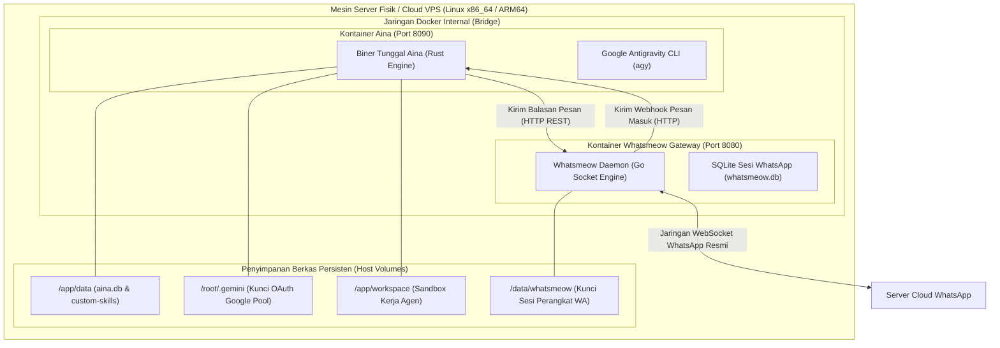

# 7. Tampilan Penyebaran (Deployment View)

> [!INFO] **Architecture Provenance & Freshness**
> - **Verified Commit**: `e9b88a2` (branch: `main`)
> - **Verified Timestamp**: `2026-10-26T11:19:12+07:00`
> - **Tracked Paths**: `src/`, `config/`, `skills/`
> - **Drift Status**: `verified`

Bab ini menjelaskan bagaimana sistem Aina dipasang, dioperasikan, dan dijalankan di infrastruktur server secara nyata (baik melalui Docker, Coolify, maupun mesin fisik Linux).

---

## 7.1 Lingkungan Infrastruktur Server (Infrastructure Overview)

Aina dirancang untuk berjalan sebagai kontainer tunggal (*single binary container*) yang sangat ringan dan mandiri, didampingi oleh kontainer gerbang Whatsmeow.

---

## 7.2 Pemetaan Komponen ke Lingkungan Penyebaran (Component Deployment Mapping)

Semua komponen blok pembangun dari Bab 5 dipetakan ke dalam proses runtime kontainer sebagai berikut:

1. **`WebhookServer`**: Berjalan sebagai listener HTTP di dalam proses biner Aina, mengikat port `8090`. Menerima webhook dari Whatsmeow dan melayani dasbor web.
2. **`CliDispatcher`**: Berjalan saat biner Aina dipanggil melalui terminal perintah kontainer (`docker exec -it aina aina <subcommand>`).
3. **`ProcessIncomingMessageUseCase`**: Berjalan di dalam memori proses utama Aina, mengorkestrasi logika bisnis secara asinkron.
4. **`PersonaEngine`**: Berjalan di dalam memori proses utama Aina, membaca file konfigurasi `config/persona.md` dan `config/organization.md`.
5. **`SqliteSessionStore`**: Mengakses file fisik database di volume persisten `/app/data/aina.db` dengan mode WAL berkecepatan tinggi.
6. **`AntigravityCliAdapter`**: Memanggil proses biner pembantu `agy` di `/root/.local/bin/agy` dan membaca token autentikasi di volume `/root/.gemini`.
7. **`WhatsmeowHttpAdapter`**: Mengirim permintaan HTTP keluar (*outbound HTTP client*) ke alamat kontainer Whatsmeow (`http://whatsmeow:8080`).
8. **`SecretBroker`**: Skrip pembantu yang terpasang di kontainer (`secret_tool` / `secret-broker`), bertugas mengambil kunci rahasia secara aman saat agen menjalankan perintah.
9. **`SkillRegistry`**: Membaca folder keahlian di `/app/skills/` dan folder keahlian persisten di `/app/data/custom-skills/`.

---

## 7.3 Persyaratan Volume Persisten (Persistent Storage Invariants)

Agar data tidak hilang saat kontainer diperbarui (*rolling update* atau *rebuild* di Coolify), 4 folder berikut wajib dihubungkan ke volume permanen:

| Jalur di Dalam Kontainer | Isi Data & Kepentingan | Akibat Jika Volume Hilang |
|:---|:---|:---|
| `/app/data` | Database SQLite (`aina.db`), riwayat chat, dan folder keahlian khusus (`data/custom-skills`). | Riwayat percakapan dan keahlian kustom hilang, sistem kembali ke setelan pabrik. |
| `/root/.gemini` | Token autentikasi OAuth Google untuk Antigravity CLI. | Pengguna harus login ulang dan menyambungkan akun Google dari awal. |
| `/app/workspace` | Tempat kerja agen saat membuat berkas olahan data atau unduhan dokumen. | File hasil olahan data sementara hilang (tidak kritis). |
| `/data/whatsmeow` | Kunci sesi enkripsi soket WhatsApp di kontainer Whatsmeow. | Koneksi WhatsApp terputus dan pengguna harus memindai ulang QR Code di ponsel. |
