# Roadmap: Enterprise Dynamic Profiling, Non-Repudiation Audit Trail & Governance

> [!IMPORTANT]
> **Status Dokumen**: Active Canonical Architecture Roadmap  
> **Komponen Target**: `aina` Core Engine (Profiler, SQLite Store, Audit Engine, Turn Capability, Persona) & Skills (`user-profiler`, `policy-broker`, `self-observability`, `memory-recall`, `tabayyun`)  
> **Referensi Induk**: Ditautkan langsung dari [`GEMINI.md`](../../GEMINI.md#4b-dynamic-profiling-non-repudiation-audit-trail--governance)  
> **Standar Kepatuhan**: NIST AI RMF 1.0, NIST SP 800-53 Rev. 5 (AU-3, AU-10), ISO/IEC 42001:2023 (AIMS), EU AI Act (Art. 12 & 86), UU No. 27 Tahun 2022 (UU PDP)  
> **Versi**: 1.0 (November 2026)

---

## 1. Ringkasan Eksekutif & Latar Belakang

Aina beroperasi di lingkungan profesional dan organisasi di mana AI bertindak sebagai rekan kerja mandiri (*autonomous co-worker*) dengan akses ke WhatsApp, terminal server, basis data, dan Google Workspace. Dalam lingkungan kantor nyata:
1. **Akuntabilitas & Non-Repudiasi**: Setiap tindakan berdampak (menjalankan script, membaca berkas, mengirim data) **wajib dapat ditelusuri secara tak terbantahkan (*non-repudiable*)** ke nomor WhatsApp pemohon sah.
2. **Dynamic Semantic Profiling**: Lawan bicara bukan sekadar entitas statis; mereka memiliki gaya komunikasi unik, preferensi format, dan keterlibatan proyek yang berevolusi seiring waktu.
3. **Penyusutan Memori (*Concept Drift Decay*)**: Memori AI tidak boleh membengkak tanpa batas atau mengingat fakta basi yang sudah tidak relevan.
4. **Kepatuhan Privasi Mandiri (*Self-Sovereign Privacy*)**: Menjamin kepatuhan terhadap UU Perlindungan Data Pribadi (UU PDP) melalui transparansi inspeksi profil dan hak untuk dilupakan (*right to be forgotten*).

Dokumen ini menetapkan peta jalan arsitektur komprehensif yang menghubungkan **profiling pengguna**, **jejak audit kriptografis**, dan **orkestrasi skill agen**.

---

## 2. Empat Pilar Arsitektur Enterprise AI Governance

```mermaid
flowchart TD
    subgraph Pilar1["Pilar 1: Dynamic Semantic Profiling"]
        A["Pesan Masuk WhatsApp"] --> B["Autonomous Profiler (Lapis 1: Regex Cepat)"]
        B --> C["Semantic Profiling (Lapis 2: JSON Preferences)"]
        C --> D["Injeksi ke Persona Prompt: Gaya Komunikasi & Proyek"]
    end

    subgraph Pilar2["Pilar 2: Non-Repudiation Audit Trail"]
        E["TurnCapability (Token 192-bit)"] --> F["Attribution Binding: sender_jid"]
        F --> G["SHA-256 Hash Chaining per Tool Call"]
        G --> H["Pencegahan Manipulasi Log (Tamper-Evident)"]
    end

    subgraph Pilar3["Pilar 3: Temporal Memory & Decay"]
        I["user_episodes (SQLite FTS5)"] --> J["Ebbinghaus Time Decay Formula"]
        J --> K["STALE Invalidation Pattern (Pembersihan Fakta Basi)"]
    end

    subgraph Pilar4["Pilar 4: Privasi Mandiri (UU PDP / GDPR)"]
        L["Perintah '!aina profilku'"] --> M["Transparansi Data Profil"]
        N["Perintah '!aina lupakan saya'"] --> O["Pembersihan Preferensi Selektif"]
    end
```



---

## 3. Matriks Rencana Implementasi Bertahap (Phased Roadmap)

Roadmap disusun dalam tahapan modular berurutan yang saling melengkapi:

### Fase 1 – 4: Fondasi Keamanan & Kontrol Akses (Telah & Sedang Berjalan)
| Fase | Dokumen Rencana | Sasaran Utama | Status |
|:---|:---|:---|:---:|
| **Fase 1** | [`PHASE_1_ZERO_TRUST_PROFILING.md`](phases/PHASE_1_ZERO_TRUST_PROFILING.md) | Invarian Zero Implicit Trust di grup WhatsApp; hardening skema profil pengguna. | **Selesai (Done)** |
| **Fase 2** | [`PHASE_2_COMPANION_DELEGATION.md`](phases/PHASE_2_COMPANION_DELEGATION.md) | Delegasi Companion di grup & DM, evolusi ke `TurnCapability` & CLI `aina policy`. | **Selesai (Done)** |
| **Fase 3** | [`PHASE_3_HIERARCHY_AWARE_UX.md`](phases/PHASE_3_HIERARCHY_AWARE_UX.md) | Persona prompt sadar hierarki (Atasan, Rekan, Tamu) & SOP penolakan santun Companion. | **Selesai (Done)** |
| **Fase 4** | [`PHASE_4_DYNAMIC_POLICY_RBAC.md`](phases/PHASE_4_DYNAMIC_POLICY_RBAC.md) | Capability scopes granular runtime & tabel kebijakan `access_policies`. | **Desain (Ready)** |

### Fase 5 – 8: Profiling Semantik, Audit Non-Repudiasi & Tata Kelola Enterprise
| Fase | Dokumen Rencana | Sasaran Utama | Komponen Target | Status |
|:---|:---|:---|:---|:---:|
| **Fase 5** | [`PHASE_5_STRUCTURED_SEMANTIC_PROFILING.md`](phases/PHASE_5_STRUCTURED_SEMANTIC_PROFILING.md) | Pemisahan identitas vs preferensi semantik JSON (`communication_prefs`, `active_projects`, `durable_constraints`). | `profiler.rs`, `session_store.rs`, `persona.rs` | **Selesai (Done)** |
| **Fase 6** | [`PHASE_6_NON_REPUDIATION_AUDIT_TRAIL.md`](phases/PHASE_6_NON_REPUDIATION_AUDIT_TRAIL.md) | Rantai hash SHA-256 tamper-evident, pengikatan atribusi eksekusi alat ke nomor WhatsApp pemohon sah (NIST AU-10 & ISO 42001). | `schema.rs`, `audit_tracker.rs`, CLI `aina audit` | **Selesai (Done)** |
| **Fase 7** | [`PHASE_7_TEMPORAL_MEMORY_DECAY.md`](phases/PHASE_7_TEMPORAL_MEMORY_DECAY.md) | Memori episodik berbasis waktu, formula penyusutan relevansi Ebbinghaus, invalidasi fakta usang (*STALE pattern*). | `memory/`, `sqlite_store/`, `skills/memory-recall/` | **Selesai (Done)** |
| **Fase 8** | [`PHASE_8_USER_GOVERNED_PRIVACY_SELF_SERVICE.md`](phases/PHASE_8_USER_GOVERNED_PRIVACY_SELF_SERVICE.md) | Kendali privasi swadaya di WhatsApp (`/profilku`, `/lupakansaya`), kepatuhan UU PDP & GDPR, sensor PII otomatis. | `builtin_commands.rs`, `sanitizer.rs`, CLI `aina user` | **Selesai (Done)** |

---

## 4. Keterlibatan & Sinergi Ekosistem Skill Agen

Profil pengguna dan log audit bukan sekadar baris database pasif; seluruhnya terintegrasi aktif dengan *built-in skills* Aina:

```text
               ┌──────────────────────────────────────────────┐
               │           Pesan Masuk WhatsApp               │
               └──────────────────────┬───────────────────────┘
                                      │
            ┌─────────────────────────┼─────────────────────────┐
            │                         │                         │
            v                         v                         v
┌───────────────────────┐ ┌───────────────────────┐ ┌───────────────────────┐
│ skills/user-profiler  │ │ skills/policy-broker  │ │ skills/tabayyun       │
│ Membaca & memperbarui │ │ Memvalidasi izin turn │ │ Klarifikasi fakta     │
│ preferensi gaya kerja │ │ capability pemohon    │ │ identitas jika ragu   │
└───────────┬───────────┘ └───────────┬───────────┘ └───────────┬───────────┘
            │                         │                         │
            └─────────────────────────┼─────────────────────────┘
                                      │
                                      v
                        ┌───────────────────────────┐
                        │ Eksekusi Tugas / Sandbox  │
                        └─────────────┬─────────────┘
                                      │
            ┌─────────────────────────┴─────────────────────────┐
            │                                                   │
            v                                                   v
┌───────────────────────┐                           ┌───────────────────────┐
│ skills/memory-recall  │                           │ skills/self-observability
│ Mengambil riwayat     │                           │ Memantau jejak audit  │
│ episode masa lalu     │                           │ & forensik anomali    │
└───────────────────────┘                           └───────────────────────┘
```

1. **`skills/user-profiler/` ([SKILL.md](../../skills/user-profiler/SKILL.md))**:
   - Membaca preferensi komunikasi dan proyek aktif lawan bicara.
   - Mengadaptasi nada bicara tanpa melanggar batasan wewenang.
2. **`skills/policy-broker/` ([SKILL.md](../../skills/policy-broker/SKILL.md))**:
   - Menerjemahkan niat delegasi Companion menjadi perintah deterministik `aina policy`.
   - Mengunci eksekusi perubahan wewenang hanya bagi Root of Trust terverifikasi.
3. **`skills/self-observability/` ([SKILL.md](../../skills/self-observability/SKILL.md))**:
   - Menyediakan inspeksi forensik mandiri bagi agen untuk melaporkan ringkasan tindakan ke Companion.
4. **`skills/memory-recall/` ([SKILL.md](../../skills/memory-recall/SKILL.md))**:
   - Menggunakan pencarian FTS5 BM25 untuk menemukan rekaman memori episodik lampau yang relevan.
5. **`skills/tabayyun/` ([SKILL.md](../../skills/tabayyun/SKILL.md))**:
   - Menjalankan klarifikasi eksplisit kepada lawan bicara bila mendeteksi inkonsistensi klaim identitas.

---

## 5. Verifikasi Berbasis Bukti (*Evidence-First Verification*)

Sesuai metodologi *Old Coder*:
1. **Uji Integritas Rantai Hash**:
   - Simulasi penyuntingan baris audit di SQLite secara sengaja -> fungsi audit wajib membunyikan alarm integritas terputus (*hash chain verification failure*).
2. **Uji Isolasi Atribusi Non-Repudiasi**:
   - Memverifikasi bahwa setiap baris `agent_tool_executions` mencatat `sender_jid` pemohon secara akurat dan tidak dapat dipalsukan oleh pengirim lain.
3. **Uji Penyusutan Waktu (Temporal Decay)**:
   - Episode berumur >90 hari otomatis disusutkan skor relevansinya dari pemanggilan Tier 1 prompt.
